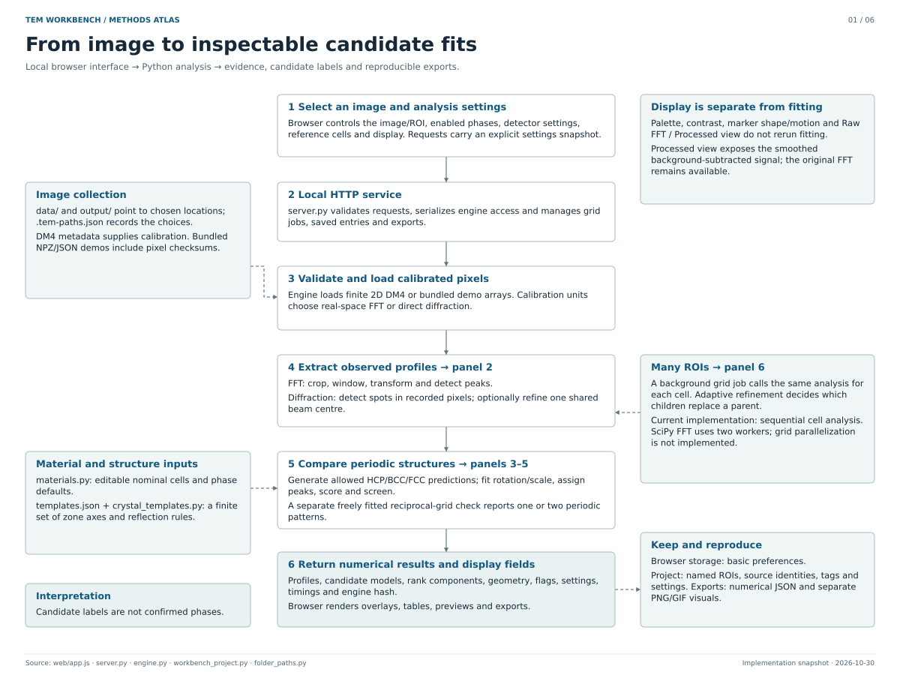

# Architecture and numerical workflow

This atlas describes the implemented TEM Workbench pipeline, including the detector-view toggle and automatic minimum-strength search. It is a reusable implementation reference for development and future methods writing, not a validation study or a paper draft.

[Download the six-page PDF](tem-workbench-architecture.pdf).



| Panel | Scope | Main implementation |
| --- | --- | --- |
| [1. System](01-system.svg) | Inputs, browser/server/engine boundaries, results and persistence | `web/app.js`, `server.py`, `engine.py` |
| [2. Signal extraction](02-signals.svg) | FFT preprocessing, direct spot detection, centre refinement and profile weights | `analysis_core.spectrum`, `diffraction.spectrum` |
| [3. Crystal predictions](03-templates.svg) | Reciprocal cells, reflection rules, finite zone library, rotation/scale fitting and assignment | `crystal_templates.py`, `scale_fitting.py`, `analysis_core.score_hypothesis` |
| [4. Scores and Auto strength](04-scores.svg) | Position score, scale preference, weak/missing evidence, acceptance screen and threshold search | `peak_evidence.py`, `scale_fitting.scale_cost`, `engine.analyze` |
| [5. Interpretation](05-decisions.svg) | Compatible, ambiguous and separate-pattern labels; independent geometry check | `phase_comparison.classify`, `analysis_core.classify`, `analysis_core.purity` |
| [6. Grid and saved state](06-grid-state.svg) | Adaptive children, passing-parent probes, reweighting, named regions and exports | `adaptive_refinement.py`, `server.py`, `engine.rescore`, `workbench_project.py` |

All pages are SVG with editable text and paths. The PDF includes bookmarks and embedded fonts. The canonical source is [architecture.json](architecture.json): each page contains named nodes, their descriptions/equations, positions and connecting arrows. Editing a generated SVG alone is possible for publication finishing, but regeneration will overwrite it. Put durable changes in the JSON.

## Update workflow

1. Review the numerical or architectural code change. Update the relevant nodes and arrows in `architecture.json`, plus its `review_date`.
2. Regenerate from the repository root. The renderer requires ReportLab (a documentation dependency, not an app runtime dependency) and a Unicode TrueType font:

   ```sh
   python -m pip install 'reportlab>=4,<5'
   python tools/render_architecture.py --record-review
   ```

   It finds DejaVu Sans through Matplotlib or a standard font location. If needed, pass `--font /path/to/DejaVuSans.ttf`. Use the same font to keep text wrapping consistent.

3. Inspect every generated page for readability, arrows, mathematical notation and overlaps. The renderer checks page bounds and text fitting, but these checks do not replace visual review.
4. Check freshness and commit the JSON, SVGs, PDF and `build.json` together:

   ```sh
   python tools/render_architecture.py --check
   ```

`--record-review` records hashes only after a human/agent review; it does not derive or verify the algorithms automatically. Normal rendering refuses to proceed if one of the tracked implementation files has changed. `--check` also detects changed diagram source, renderer or output files and requires no ReportLab installation. The source hashes avoid relying on a commit ID that would change when the diagrams themselves are committed.

## Notation and limits

- Reciprocal distances are cycles per nm, without a 2π factor. `q` is a measured or predicted reciprocal vector; `τ` is the matching radius. Opposite spots are grouped into one independent profile.
- `w` is a bounded evidence weight, `C` is weighted profile coverage, `P` is position score, `S` is scale cost, `B` is weak-peak bonus factor, `F` is unsupported-prediction fraction, and `R = P − S + ηB − ηF` is rank. `λ` controls scale cost; `η` controls prediction-site evidence. These quantities are not probabilities or measured phase fractions.
- The displayed HCP indices use Miller–Bravais notation; reciprocal construction and the zone law use three-index coordinates internally. Allowed positions are not a calculated intensity distribution.
- Algorithm limits and default values are implementation choices. Material references, detector thresholds, fitting limits and weights can be changed by the user. The finite zone library and bounded searches can miss a better hypothesis.
- Automatic minimum strength searches the profile subsets already admitted by the other detector settings. It can improve rank by excluding poorly matched profiles; it is not independent evidence that a phase is correct.
- Geometry-only grids have separate acceptance criteria. They describe periodic organization of peaks without assigning a crystal structure.
- **Auto: overall scale + HCP c/a** is now an optional mode. It uses the same broad positional search as independent a*/c*, but decomposes the ranking cost into overall reciprocal scale `s = sqrt(sa × sc)` and real-space ratio multiplier `r = sa/sc`. Cost is `λ[ln(s)/ln(1.05)]² + μ[ln(r)/ln(1.05)]²`, with independently adjustable weights defaulting to 0.10. Cubic and c-insensitive HCP fits have no ratio term. Existing per-axis bounds remain; no tighter material-specific c/a cap is imposed. This ranks explored positional fits; it does not optimize coordinates against the penalty.
